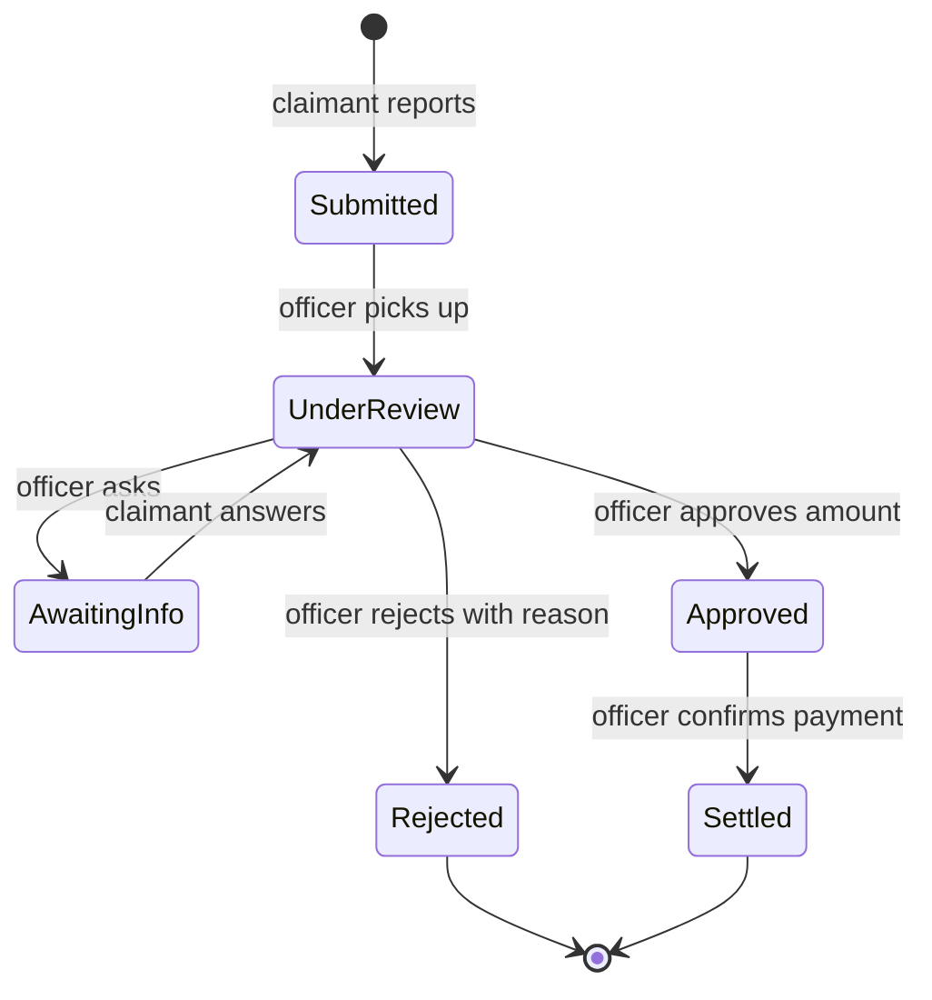
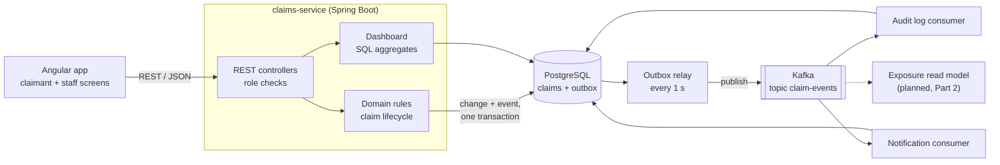

# Claims Platform

A motor and property claims platform for six APAC markets, built as a take-home assessment for Chubb APAC (Young Graduate Program, Full-stack Developer).

Claimants report incidents, track their claims, answer questions and receive decisions. Claims staff pick up claims, assess them, approve and settle or reject them, and see their team's workload, performance and liability exposure. Both user types use the same Angular application.

**Stack:** Java 21 · Spring Boot 4.1 · PostgreSQL 17 · Flyway · Kafka 4.1 · Angular 22 · Angular Material · Docker Compose · Testcontainers

---

## Quick start

### Prerequisites
- **Docker Desktop** (runs Postgres and Kafka, and the backend's integration tests). Start it before the backend: the backend publishes claim events to Kafka.
- **Java 21** (Maven is not needed: the project includes the Maven wrapper)
- **Node.js** (current LTS) with npm

### 1. Start Postgres and Kafka
```bash
docker compose up -d
```

### 2. Start the backend (port 8081)
```bash
cd backend/claims-service
./mvnw spring-boot:run        # Windows: .\mvnw.cmd spring-boot:run
```
Flyway creates the schema and loads the demo data on first start. The port defaults to **8081** and can be changed with the `PORT` environment variable.

### 3. Start the frontend (port 4200)
```bash
cd frontend/claims-web
npm install
npm start
```
Open **http://localhost:4200**. API calls to `/api` are proxied to the backend.

### Useful addresses
| | |
|---|---|
| App | http://localhost:4200 |
| Swagger UI (API docs, try requests) | http://localhost:8081/swagger-ui.html |
| OpenAPI spec | http://localhost:8081/v3/api-docs |
| Health | http://localhost:8081/actuator/health |

### Reset the demo data
Testing changes the claims. To go back to the original seeded data:
```bash
docker compose down -v        # removes the database volume
docker compose up -d
```
Then restart the backend; Flyway recreates the schema and demo data.

---

## Demo

### Users
There is no sign-in screen yet. Pick a user from **"Viewing as"** in the top bar; the user's role decides which screens appear. This is a temporary stand-in: the app sends the chosen user's id in an `X-User-Id` header, which the backend uses for its role checks. JWT sign-in is planned to replace it.

| User | Role | Notes |
|---|---|---|
| Alice Tan | Claimant | Two Singapore policies (motor, property), in SGD |
| Ben Lim | Claimant | One Malaysia motor policy, in MYR |
| Priya Nair | Staff | Holds two of the seeded claims |
| Daniel Wong | Staff | Holds two of the seeded claims |

The seed data has five claims, one in each status except *Settled*, so every screen has something to show.

### Five-minute walkthrough
1. **Report an incident:** as **Alice**, click *Report an incident*, choose a policy, and submit. The claim appears at the top of *My claims* as *Submitted*.
2. **Pick it up:** switch to **Priya**. In the *Work queue* (filter *Unassigned*), open the claim and click *Pick up*.
3. **Ask a question:** click *Request info* and send a question. The claim moves to *Awaiting info*.
4. **Answer:** switch to **Alice**, open the claim from *My claims*, and answer the question. The claim returns to *Under review*.
5. **Decide:** switch to **Priya**. *Approve* an amount (up to the coverage limit), then *Mark as settled*, or *Reject* with a reason. Switch back to **Alice** to see the decision.

Along the way, Alice's **bell** (top bar) shows a notification for each of Priya's status changes. These are created through Kafka: claim change → outbox → `claim-events` topic → notification consumer.

Then open **Team dashboard** as Priya to see workload, performance and liability exposure.

---

## Features

### Claimants
| Brief | Feature |
|---|---|
| Report an incident | Form with policy, incident date, description and estimated loss. Checks: own policy only, date not in the future and within the policy period, description 10–2000 characters, amount above 0 |
| Track their claim | *My claims* list and a claim page with details, timeline (who changed what, when) and questions |
| Provide additional information when asked | Answer box on the claim page while a question is open |
| Receive decisions | Decision banner: approved amount, settled amount, or rejection reason |
| Be kept informed | Bell with unread count: a notification for every status change made by staff (not for the claimant's own actions), created asynchronously via Kafka |

Claimants never receive internal figures: the API leaves out the reserve and the officer's internal id.

### Claims staff
| Brief | Feature |
|---|---|
| Pick up incoming claims | *Work queue* with *All / Unassigned / Assigned to me* filters; *Pick up* assigns the claim to you |
| Review and assess | Claim page with details, history and Q&A; revise the reserve; request information |
| Progress to settlement or rejection | Approve (up to the coverage limit), mark as settled, or reject with a reason. Only the assigned officer can act; final actions ask for confirmation |
| See the team's workload and performance | *Team dashboard*: unassigned queue, workload per officer, performance per officer (counts and average durations) and liability exposure per currency |

### Claim lifecycle


---

## Architecture



**One service, split into modules** (`claim`, `policy`, `user`, `dashboard`). In a 2–5 hour sprint, each extra service adds a build, configuration and a failure point; package boundaries keep the seams visible, so a module can be extracted later.

**REST vs Kafka**
| | Used for | Why |
|---|---|---|
| **REST** | Everything a user waits on: submitting a claim, staff actions, lists, the dashboard | The user needs an immediate answer: validation errors, the new claim number, the updated status |
| **Kafka** | What happens *because* of a change: the **audit log** and **claimant notifications** (built); the exposure read model (planned, Part 2) | Work that can lag by a second without harm. A slow or failing consumer can't block a claim submission |

**How an event travels:** the claim change and its event are saved in **one database transaction** (a *transactional outbox*), so an event exists only if the change committed. A relay publishes outbox rows to the `claim-events` topic (key = claim id, so each claim's events stay in order) and marks them sent once Kafka confirms. If Kafka is down, claims keep working and events wait. Delivery is *at least once*; consumers ignore duplicates by event id. A failing event is retried 3 times, then moved to `claim-events.DLT`.

The dashboard is still calculated live with SQL (fine at this scale).

**API contract:** code-first. The backend generates the OpenAPI spec (`/v3/api-docs`, browsable in Swagger UI), and the frontend's types mirror it.

**Errors:** RFC 9457 Problem Details, with per-field messages for validation. Codes: 400 invalid input, 401 no user, 403 wrong role or not the assigned officer, 404 not found (also for someone else's claim, so ids can't be probed), 409 action doesn't fit the claim's status.

### Main endpoints
| Who | Method and path | Purpose |
|---|---|---|
| Claimant | `GET /api/me/policies` | Own policies |
| Claimant | `POST /api/claims` | Report an incident |
| Claimant | `GET /api/me/claims`, `GET /api/me/claims/{id}` | Own claims; one claim with decision, timeline, questions |
| Claimant | `POST /api/claims/{id}/answer` | Answer the open question |
| Claimant | `GET /api/me/notifications` · `POST …/{id}/read` · `POST …/read-all` | Bell: notifications and unread count |
| Staff | `GET /api/claims?filter=ALL\|UNASSIGNED\|MINE` | Work queue |
| Staff | `GET /api/claims/{id}` | One claim in full, including the reserve |
| Staff | `POST /api/claims/{id}/pick-up` · `PUT …/reserve` · `POST …/request-info` · `…/approve` · `…/reject` · `…/settle` | Claim actions |
| Staff | `GET /api/dashboard` | Team dashboard |

The full list is in Swagger UI.

---

## Testing

```bash
# Backend: 101 tests (needs Docker running: Testcontainers starts Postgres and Kafka)
cd backend/claims-service
./mvnw test                   # Windows: .\mvnw.cmd test

# Frontend: 2 tests
cd frontend/claims-web
npx ng test --watch=false
```

The backend tests include unit tests for the claim lifecycle, validation rules and notification rules, and **integration tests against real PostgreSQL and Kafka** started automatically in Docker. These cover every endpoint, the role and ownership checks, that claimant responses never contain internal figures, dashboard figures checked against hand-calculated values, and the full event flow (outbox → Kafka → audit log and notifications, duplicates ignored, no event for a rejected action).

---

## Project structure
```
├── backend/claims-service/       Spring Boot service
│   └── src/main/java/com/chubb/claims/
│       ├── claim/                claims: lifecycle, actions, API
│       ├── policy/               policies
│       ├── user/                 users and the temporary identity stub
│       ├── dashboard/            team dashboard queries
│       ├── events/               outbox, relay, Kafka topics, consumers
│       ├── notification/         claimant notifications API
│       └── web/                  error handling
│   └── src/main/resources/db/
│       ├── migration/            Flyway schema
│       └── seed/                 demo data (local profile only)
├── frontend/claims-web/          Angular app
│   └── src/app/
│       ├── claimant/             My claims, report form, claim page
│       ├── staff/                work queue, claim page, dashboard
│       ├── claims/               shared claim types and API calls
│       └── core/                 current user, route guards, notification bell
├── docs/decisions.md             decisions, business rules, known gaps
├── AI_JOURNAL.md                 how AI was used: asked, accepted, challenged, overridden
└── docker-compose.yml            Postgres + Kafka
```

---

## Further reading
- **[docs/decisions.md](docs/decisions.md):** architecture decisions with trade-offs, every business rule (with its code and test), what claimants can see, how dashboard figures are calculated, and **known gaps**.
- **[AI_JOURNAL.md](AI_JOURNAL.md):** a running log of what I asked the AI, what I accepted, challenged and overrode, including bugs the tests caught.

### Main known gaps
Exposure read model (Kafka Part 2) not yet built · temporary `X-User-Id` identity instead of JWT · no live push for notifications · no pagination · no reassignment or appeal flow · dashboard has no time filter. Details and reasons are in [docs/decisions.md](docs/decisions.md).
